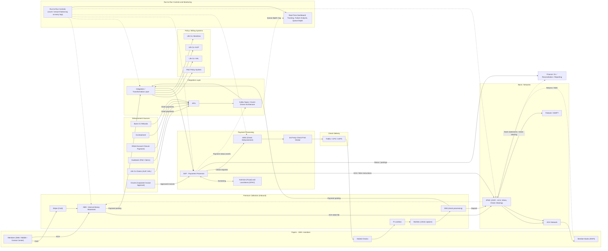

# FI Payments Ecosystem – Current State Architecture

> Based on the described scope. Systems named by you are used as stated; roles of IMM vs. SAP and the control/dashboard components are inferred and should be validated.

## 1. Logical architecture

## 2. Flow summary

| Flow | Path |
|---|---|
| Premium - Card | Member → Stripe → IMM → Integration layer → P&C / HAL / ALIP / Benekiva |
| Premium - ACH | Member → IMM → JPMC (ODFI) → ACH network → member bank; returns back via JPMC |
| Premium - Check | Member → FI lockbox → Banktec → DMI → clear via JPMC → posting to policy systems |
| Disbursement - ACH / Wire | Source system → APIs / Kafka → Integration layer → SAP → Actimize / LexisNexis screening → JPMC |
| Corporate AP | Oracle approval → SAP → screening → JPMC (ACH / wire) or ARIS (check) |
| Disbursement - Check | SAP → ARIS → 3rd party print vendor → FedEx / UPS / USPS |
| Controls | Run-to-run balancing at every hop; events and queue metrics feed a real-time dashboard |
