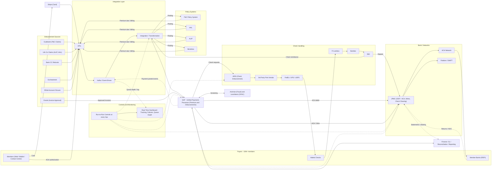

# FI Payments Ecosystem – Target State Architecture

> IMM (legacy premium rail) is retired. SAP becomes the single payments processor for premium collections and disbursements, behind the common integration layer. Placement of Stripe and the lockbox flows under SAP is inferred; validate.

## Current to target changes

| Area | Current | Target |
|---|---|---|
| Premium processing | IMM | SAP via integration layer |
| Disbursements | SAP | SAP (unchanged) |
| Card | Stripe → IMM | Stripe → integration layer → SAP |
| ACH premium | IMM → JPMC | SAP → JPMC |
| Screening | Disbursements only | Applied to all SAP payments (assumed) |
| Controls / dashboard | Per hop incl. IMM | Per hop; IMM removed |
